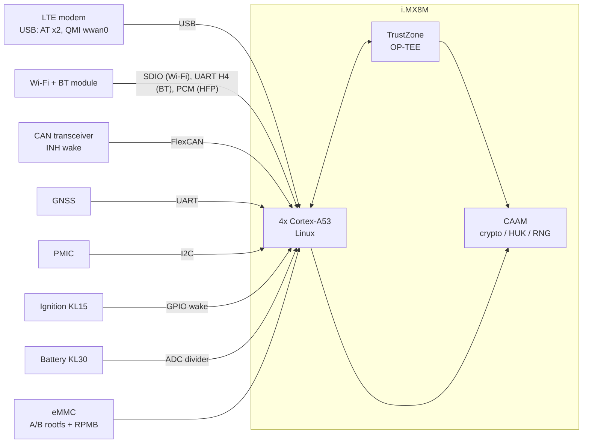
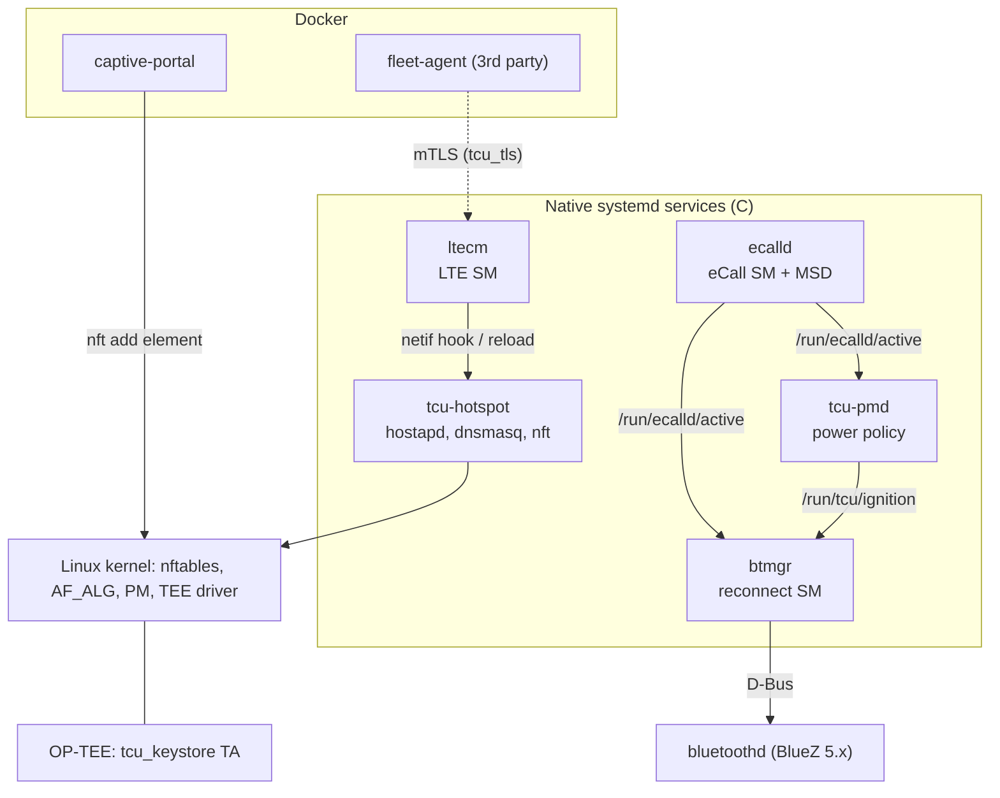
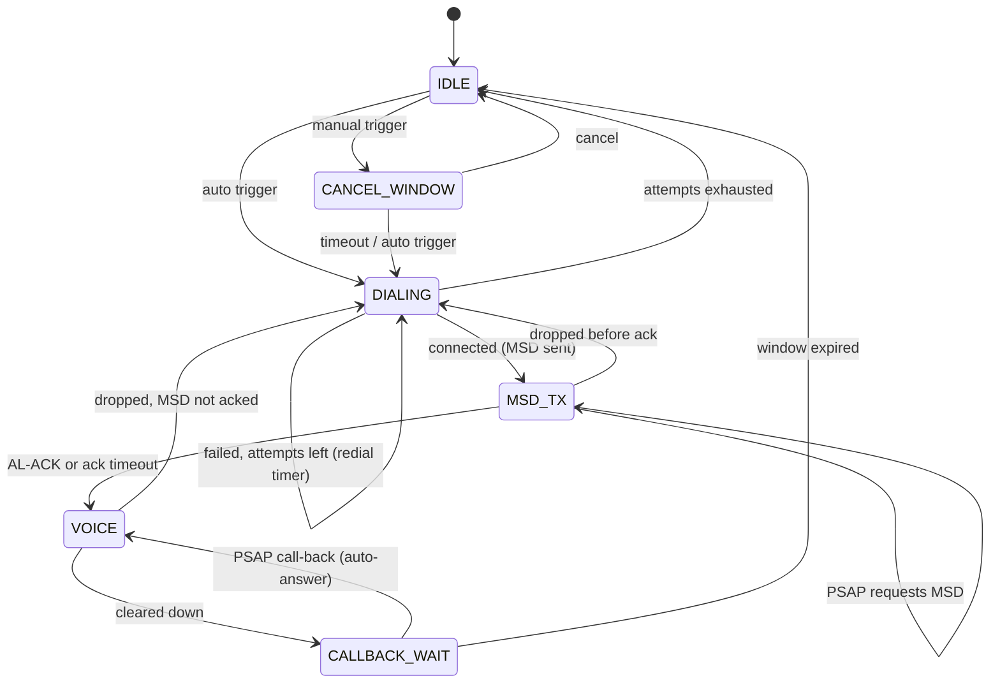
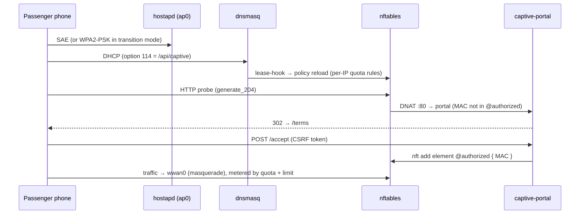
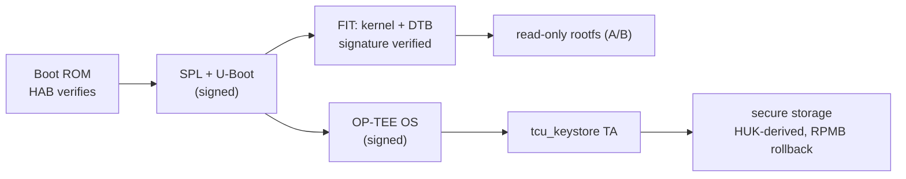

# Telematics Control Unit (TCU) — Software Design

| | |
|---|---|
| Platform | NXP i.MX8M (Cortex-A53), LTE Cat-4 modem, Wi-Fi 5 / BT 5 combo module |
| Legacy platform | NXP i.MX6 (OP-TEE port, same software stack) |
| OS | Custom Yocto distribution `tcu` (Poky base, systemd) |
| Status | Reference design and source for the services in this repository |

## 1. Scope and goals

The TCU is a heavy-truck telematics unit. Its software provides:

1. **eCall**: automatic and manual emergency calls carrying the EN 15722 Minimum Set of Data (MSD).
2. **Connectivity**: an LTE data bearer that stays up through coverage gaps, and SCTP/TCP/IP networking.
3. **Bluetooth**: hands-free (HFP 1.7 wideband speech) for the driver's phone, with reliable reconnection.
4. **Wi-Fi**: a passenger hotspot (SoftAP tethered to LTE) with per-passenger data policy, a captive portal and WPA3, plus station mode for depot OTA.
5. **Security**: a hardware-rooted chain of trust, device identity in TrustZone, mTLS with OCSP to the backend, and AAA for engineers' SSH access.
6. **Power management** on permanent battery (KL30), with standby and deep-sleep budgets.
7. **Containerised** passenger-facing and third-party workloads.
8. **Automated nightly hardware-in-the-loop (HIL) regression.**

Non-goals for this document: the backend, the HMI and the CAN gateway firmware.

## 2. Hardware platform

### 2.1 SoC selection

Candidate application processors were benchmarked against the product's
workload rather than on datasheet numbers. The evaluation harness ran the
same Yocto image on each EVK and measured:

| Criterion | How it was measured | Weight |
|---|---|---|
| Crypto throughput | `tcu-hash` (AF_ALG) and OpenSSL `speed` with and without the hardware engine | high |
| Hotspot forwarding | iperf3 through nftables with quota and limit rules at full client load | high |
| Cold-boot to eCall-ready | time from power-on to `ecalld` accepting a trigger | high (regulatory) |
| Standby current | suspend-to-RAM with modem RI and CAN wake sources armed | high |
| TrustZone / secure boot | maturity of HAB/AHAB, OP-TEE upstream support, OTP key handling | gate |
| Longevity and grade | automotive/industrial temperature grade, 10+ year supply | gate |
| BSP health | mainline/LTS kernel, Yocto layer quality | medium |

The i.MX8M was chosen for its CAAM crypto engine (AF_ALG offload, a
hardware unique key for OP-TEE secure storage), HAB secure boot, upstream
OP-TEE support and its temperature grade. The per-candidate measurements
live in the hardware selection report; they are not reproduced here.

### 2.2 Block diagram



### 2.3 Hardware customization and peripheral interfacing

- **Device tree**: one board DTS on top of the EVK DTSI. It sets pinmux for the modem power/reset GPIOs, the BT `serdev` node (`brcm,bcm43438-bt`-class compatible with host-wake and device-wake GPIOs), PCM routing for HFP, and the ignition GPIO as a `gpio-keys` wakeup source.
- **Wake sources**: modem RI, CAN INH, ignition and the RTC alarm are enabled under `/sys/devices/.../power/wakeup` by the PM boot hook (§9).
- **Battery sensing**: an ADC channel exposed through IIO; `tcu-pmd -k` takes the divider ratio.
- **Modem**: USB composite device. `ttyUSB2` is the control AT port (owned by `ltecm`), `ttyUSB3` is the eCall AT port (owned by `ecalld`), and `wwan0` is the raw-IP data interface.

## 3. Software architecture



**Design rules**

- **Pure state machines.** Each service's logic (`ecall_sm`, `lte_sm`, `bt_reconnect`, `hfp_codec`, `pm_policy`, `msd`) has no OS dependencies. All side effects go through an `*_ops` callback table, so the decision logic is unit-tested on the host (`tests/c`). The daemons are thin event loops: `poll()` on tty/timerfd/socket, or a GLib main loop for D-Bus.
- **Simple cross-service signals.** Services signal each other through files under `/run`, not an IPC bus. Each consumer polls at 1 Hz, which is fast enough for these signals and survives any one daemon restarting.
- **Safety first.** eCall overrides every other policy: power stays up, Bluetooth paging stops and audio is routed to the PSAP. `ecalld` runs with `OOMScoreAdjust=-1000` and the highest CPU weight.
- **Native vs container split.** Platform and safety services run natively. Passenger-facing and third-party code runs in containers.

## 4. Yocto distribution (`meta-telematics`)

```
meta-telematics/
├── conf/distro/tcu.conf              systemd, PAM, seccomp, virtualization; x11/wayland removed
├── conf/templates/default/           local.conf / bblayers.conf for `oe-init-build-env`
├── recipes-core/images/
│   ├── tcu-image.bb                  production: read-only rootfs, no debug-tweaks, no telnet
│   └── tcu-image-dev.bb              lab: debug tools, telnetd, writable rootfs
├── recipes-telematics/tcu-apps/      this repo's CMake project + systemd units + ecall user
├── recipes-connectivity/bluez5/      BlueZ policy (main.conf), trimmed profiles
├── recipes-kernel/linux/             tcu.cfg: AF_ALG+CAAM, TEE, SCTP, nftables, PM, containers
├── recipes-bsp/u-boot/               no autoboot interrupt, silent console, FIT signature, bootcount
├── recipes-security/
│   ├── optee/                        OP-TEE flavours (i.MX6 port, CAAM HUK, RPMB)
│   ├── tcu-keystore-ta/              device identity TA + client
│   ├── openssh/                      hardened sshd_config (certs + PAM 2FA, service VLAN only)
│   └── tcu-aaa/                      PAM: RADIUS + TACACS+ + LDAP
└── recipes-containers/tcu-containers/  compose stack + unit, images preloaded, never pulled
```

Build:

```sh
TEMPLATECONF=../meta-telematics/conf/templates/default source poky/oe-init-build-env build-tcu
bitbake tcu-image          # or tcu-image-dev for the lab
```

**Telnet** exists only in `tcu-image-dev`, for bench units that have no
provisioned SSH keys yet. The production image never contains it, and the
hotspot input chain drops all passenger traffic to the TCU itself.

## 5. eCall

### 5.1 State machine (`src/ecall/ecall_sm.c`)



Key decisions:

- An automatic eCall cannot be cancelled. A crash during a manual call's cancel window escalates it to automatic.
- Voice always opens, even when the MSD acknowledgement never arrives. The data link must never leave the occupants without voice.
- The unit stays registered for PSAP call-back for 60 minutes after the call clears, and auto-answers.

### 5.2 MSD (`src/ecall/msd.c`)

The MSD is bit-packed using ASN.1 PER constrained-integer rules (value
minus lower bound, in the minimum number of bits) over the EN 15722 value
ranges. It carries the VIN (6-bit alphabet without I/O/Q), position in
milliarcseconds, direction, the two most recent position deltas,
propulsion type and passenger count. The encoder round-trips through its
own decoder, rejects out-of-range input, and stays within 140 bytes.
**Before homologation it must be replaced by, or cross-checked against, a
conformance-tested ASN.1 UPER codec**, because the optional-data framing
of the full schema is not implemented.

### 5.3 Modem adaptation

`AT+CECALL=<type>` (3GPP TS 27.007) starts the call. MSD upload and in-band
modem progress reporting are vendor-specific, so they are gathered in one
table in `ecalld.c` (`modem.*`). The URC strings in that table are
**placeholders**: replace them with your modem vendor's commands when porting.

## 6. LTE connectivity stack

```mermaid
stateDiagram-v2
  [*] --> OFF
  OFF --> MODEM_INIT: start
  MODEM_INIT --> SIM_WAIT: ATE0, CMEE, CEREG=2, CFUN=4 ok
  SIM_WAIT --> SEARCHING: +CPIN READY (CFUN=1)
  SEARCHING --> PDN_CONNECTING: CEREG home / roaming (if allowed)
  PDN_CONNECTING --> CONNECTED: CGDCONT, CGACT ok (netif up)
  CONNECTED --> SEARCHING: registration lost (netif down)
  SEARCHING --> BACKOFF: timeout (radio cycle; re-init after N)
  SEARCHING --> BACKOFF: registration denied
  PDN_CONNECTING --> BACKOFF: error / timeout
  MODEM_INIT --> BACKOFF: error (re-init)
  SIM_WAIT --> BACKOFF: SIM not ready (re-init)
  BACKOFF --> SEARCHING: timer (cycle radio)
  BACKOFF --> MODEM_INIT: timer (re-init)
```

- **Backoff** is capped exponential (2 s to 5 min) with ±20% jitter, so a fleet does not retry in lock-step after a cell outage. It resets on success.
- **Registration denied** never triggers fast retries, because networks escalate bans on aggressive devices.
- **USB re-enumeration** (modem crash or firmware update): `ltecm` exits on `POLLHUP`. systemd `BindsTo=` the tty device restarts it when the port comes back.
- **netif hook** (`config/ltecm-netif-hook`) runs DHCP on `wwan0`, writes `/run/tcu/resolv.wwan` for dnsmasq, and reloads the hotspot policy.
- **SCTP** is built as a module (`CONFIG_IP_SCTP=m`, `lksctp-tools`) for backend links that need multi-streaming and multi-homing.

## 7. Bluetooth (BlueZ 5.x)

### 7.1 Reconnection (`src/bt/bt_reconnect.c`, `btmgr`)

BlueZ's built-in `[Policy] ReconnectAttempts` handles short link drops
(3 attempts over 7 s). `btmgr` owns everything that needs vehicle context.
It replaces the earlier fixed-interval retry loop, and each field issue
below has a unit test in `tests/c/test_bt_reconnect.c`:

| # | Field issue | Fix |
|---|---|---|
| 1 | Phone and TCU page each other at the same time; the late `InProgress` error tore the new link down | First `Connected=true` wins; our page is abandoned without `Disconnect()` |
| 2 | Phone deleted the pairing; stale-key retries popped a pairing dialog on the phone every few seconds | Auth failure → `NEEDS_REPAIR`; retries stop until the HMI re-pairs |
| 3 | Driver disconnected on the phone; the TCU kept reconnecting | Remote-user disconnect (BlueZ ≥ 5.69 `Disconnected` reason) → `SUSPENDED` until next ignition |
| 4 | `bluetoothd` restart lost state | `WAIT_ADAPTER`, then resume on `Powered=true` |
| 5 | Unbounded retries drained the battery in standby | Retry budget per ignition cycle; nothing pages with ignition off |
| 6 | Paging during an eCall disturbed the call | eCall suspends paging; an existing link is kept |

### 7.2 HFP 1.7 wideband speech (`src/bt/hfp_codec.c`)

The HF side advertises codec negotiation only when the controller supports
transparent eSCO. It answers `+BCS` with `AT+BCS` for supported codecs, and
with `AT+BAC` otherwise, as the specification requires. Synchronous
connection parameters follow the HFP 1.7 ladders: T2 → T1 for mSBC, and
S4 → S3 → D1 for CVSD, with S4 used only when both sides advertise it.

**Field fix:** some phone and controller pairs accept mSBC and then fail
every eSCO setup. After the mSBC ladder is exhausted, the codec is
blacklisted for that phone, and the next negotiation offers CVSD only. The
call drops to narrowband instead of having no audio. This module is the
codec policy used by the hands-free backend.

## 8. Wi-Fi: passenger hotspot



- **SoftAP + LTE tethering**: `ap0` is a virtual interface on the same PHY as `wlan0`, so depot OTA over station mode keeps working. Traffic is masqueraded out of `wwan0`.
- **Per-passenger policy** (`hotspot_policy.py`): a default-drop forward chain, plus a named quota (shared by uplink and downlink) and a named rate limit for each passenger. Driver devices can be exempted. The ruleset is applied atomically with `nft -f`. **Reloads carry over** portal sign-ins and quota usage (read from `nft -j`), so a DHCP renewal can neither reset a passenger's allowance nor log them out. Verified by applying it in a network namespace.
- **Isolation**: `ap_isolate=1`, no forwarding from `ap0` to `ap0`, and the input chain drops all passenger traffic to the TCU's own services except DHCP, DNS and the portal.
- **Captive portal**: answers OS detection probes with a 302, implements the RFC 8908 API (advertised through RFC 8910 DHCP option 114), and uses a CSRF-protected accept. It runs in a container that has only `CAP_NET_ADMIN`.
- **WPA3 migration**: deploy SAE + WPA2-PSK transition mode first (PMF optional, `sae_require_mfp=1`), then switch to WPA3-only (`ieee80211w=2`) through fleet config once the client mix allows it. The HIL suite covers all three modes and legacy WPA2-only clients.

## 9. Power management

| State | Entered when | Platform state | Wakes on |
|---|---|---|---|
| ACTIVE | ignition on, or eCall active | full run | – |
| GRACE | ignition off | full run, uploads/OTA allowed | – |
| STANDBY | grace elapsed with no wakelocks (hard cap 30 min) | suspend-to-RAM, modem PSM/eDRX | ignition, modem RI, CAN INH, RTC (hourly keep-alive) |
| DEEP_SLEEP | 72 h in standby, battery low, or critically low at ignition-off | powered off via PMIC | ignition only |

- **Wakelocks**: applications take mainline `CONFIG_PM_WAKELOCKS` locks through `/sys/power/wake_lock`; `tcu-pmd` only counts them. After each resume the system stays up for 15 s so the woken application can take a lock.
- **Time base**: `CLOCK_BOOTTIME`, so standby time is counted while suspended.
- **Battery**: an unknown reading (ADC missing) never forces deep sleep. A critically low battery skips standby altogether, so the truck can still start.

## 10. Security architecture



- **Boot**: HAB verifies SPL and U-Boot, and U-Boot verifies a signed FIT image. Production U-Boot cannot be interrupted (`BOOTDELAY=-2`). A boot counter with A/B slots provides OTA rollback.
- **OP-TEE** (ported to i.MX6 and used on i.MX8): secure storage keyed from the CAAM hardware unique key, with RPMB anti-rollback.
- **Device identity / PKI**: a P-256 key is generated inside the `tcu_keystore` TA, restricted to signing and never extractable. At end of line the public key is turned into a CSR, the fleet device CA issues the certificate, and `scripts/provision_device_cert.sh` installs the chain.
- **TLS** (`src/security/tls_client.c`, OpenSSL 3): TLS 1.2 minimum, AEAD ciphers only, hostname verification, mutual auth. The OCSP staple is checked for signature, validity window (±5 min) and certificate status; a revoked certificate always fails, and a missing staple fails when `require_ocsp` is set. Verified against `openssl s_server` with good, revoked and missing staples, and with a hostname mismatch.
- **Kernel crypto API** (`src/security/afalg.c`): hashing and HMAC through AF_ALG are served by CAAM. `tcu-hash` verifies OTA images without loading the A53 cores.
- **SSH**: OpenSSH only (no Dropbear). It listens on the service VLAN only, accepts user certificates signed by the fleet CA, and then requires keyboard-interactive login through PAM.
- **AAA**: PAM chains RADIUS (OTP), with TACACS+ as an alternative for authentication and as per-command authorisation and accounting. LDAP decides `tcu-service` group membership. Fast timeouts mean a dead AAA server cannot stall a field session. `pam_radius` and `pam_tacplus` recipes must come from the company layer (they are not in the public layers).
- **Service hardening**: systemd sandboxing on every unit (`ProtectSystem`, `NoNewPrivileges`, dedicated users, capability bounding).

## 11. Containers

Docker (meta-virtualization `docker-moby`) runs the captive portal and the
third-party fleet agent. Every container drops all capabilities except the
one it needs, has a read-only rootfs, sets `no-new-privileges`, and has
memory, PID and CPU limits. The fleet agent sits on an `internal` bridge
with no direct route to `wwan0`. Images ship inside the A/B rootfs and are
`docker load`ed at boot, never pulled while on the road.

## 12. Test strategy

| Level | What | Where | When |
|---|---|---|---|
| Unit (C) | every state machine and codec, with ASan/UBSan | `tests/c` (ctest) | every commit |
| Unit (Python) | policy rendering, nft syntax, live-state carry-over, portal HTTP handler | `tests/unit` | every commit |
| HIL, simulated | full HIL suite against `tcu_testkit.sim`, using the real portal and policy code | `tests/hil --testbed sim` | every commit |
| HIL, bench | head unit, legacy client, 2 programmable APs + attenuators, sniffer, DUT | `tests/hil --testbed lab1.json` | nightly (Jenkins) |

**Framework (`tests/framework/tcu_testkit`)**: device drivers (`TcuDut`,
`HeadUnit`, `ProgrammableAP`, `Sniffer`) work over SSH with connection
multiplexing. Roam time is measured from the sniffer capture (Reassociation
Request to EAPOL 4/4 or FT Reassociation Response), not from client logs.
The connect matrix is generated from the bench's channel list, so adding a
channel or AP grows the nightly run automatically. On a failure, the DUT
journal is attached to the JUnit report.

## 13. Repository map

| Area | Path |
|---|---|
| eCall | `src/ecall/` |
| LTE | `src/lte/` |
| Bluetooth | `src/bt/` |
| Power | `src/pm/` |
| Security tools | `src/security/`, `optee/`, `scripts/provision_device_cert.sh` |
| Hotspot | `src/hotspot/`, `config/` |
| Services | `systemd/` |
| Yocto | `meta-telematics/` |
| Containers | `docker/` |
| Tests / CI | `tests/`, `Jenkinsfile` |

## 14. Known gaps and porting checklist

- [ ] Replace the placeholder MSD/URC strings in `ecalld.c` with the modem vendor's commands, and validate the MSD against a conformance-tested ASN.1 codec.
- [ ] Board DTS and the memory map in `optee-os_%.bbappend` (values shown are board-specific examples).
- [ ] `pam-radius` and `pam-tacplus` recipes in the company layer; fleet AAA endpoints and secrets go in provisioning.
- [ ] Audio routing hand-off from `ecalld` to the audio manager (currently logged only).
- [ ] Pin `SRCREV` in `tcu-apps` and `tcu-keystore-ta` for release builds.
- [ ] Verify AF_ALG on target. It is skipped in containers that block the socket family; check `/proc/crypto` for `*-caam` drivers.
