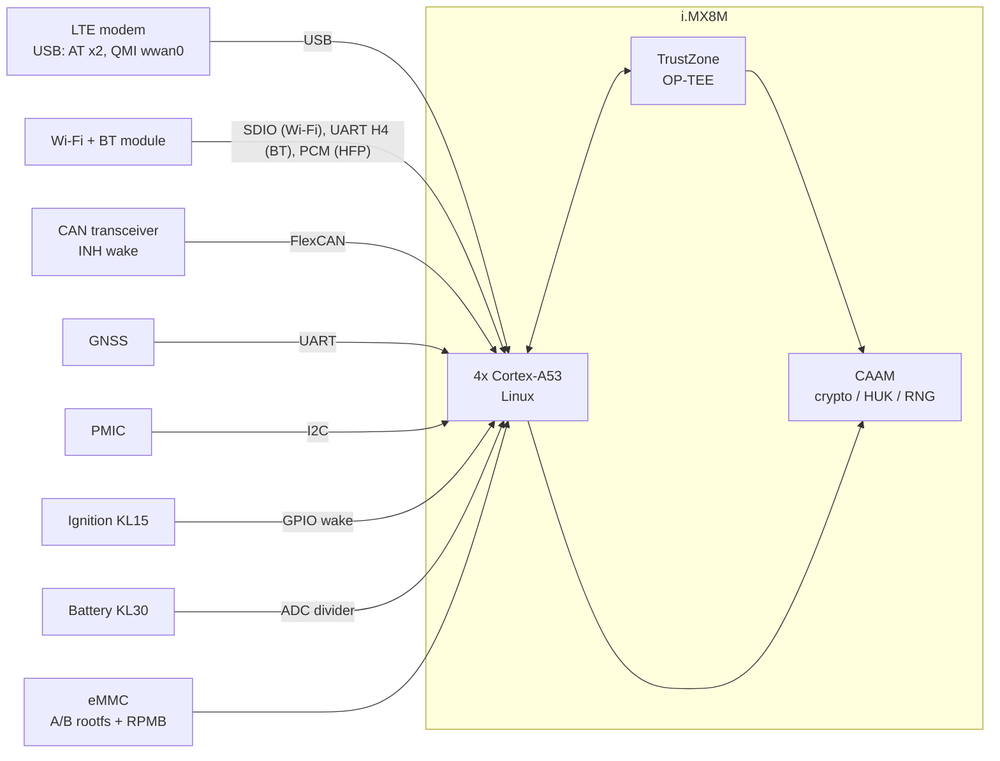
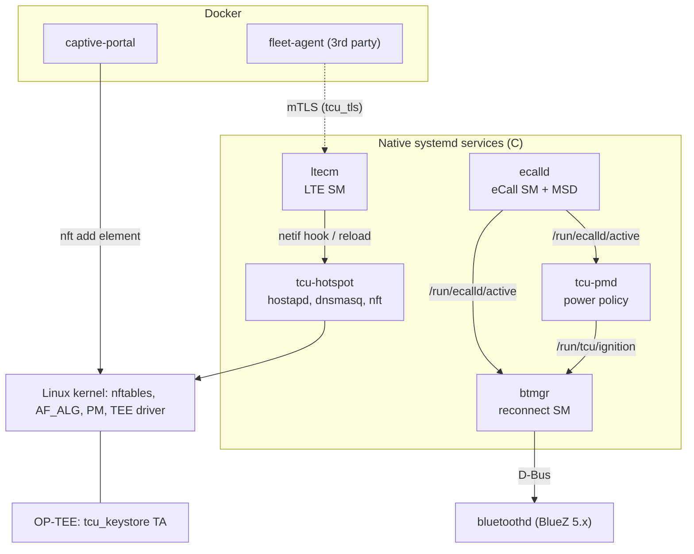
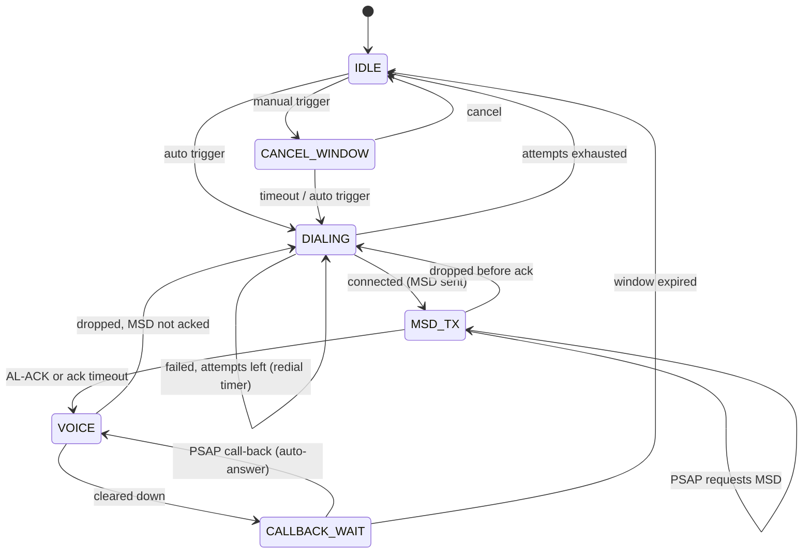

# Telematics Control Unit (TCU) — Software Design

| | |
|---|---|
| Platform | NXP i.MX8M (Cortex-A53), LTE Cat-4 modem, Wi-Fi 5 / BT 5 combo module |
| Legacy platform | NXP i.MX6 (OP-TEE port, same software stack) |
| OS | Custom Yocto distribution `tcu` (Poky base, systemd) |
| Status | Reference design and source for the services in this repository |

## 1. Scope and goals

The TCU is a heavy-truck telematics unit. Its software provides:

1. **eCall**: automatic and manual emergency calls carrying the EN 15722 Minimum Set of Data (MSD).
2. **Connectivity**: an LTE data bearer that stays up through coverage gaps, and SCTP/TCP/IP networking.
3. **Bluetooth**: hands-free (HFP 1.7 wideband speech) for the driver's phone, with reliable reconnection.
4. **Wi-Fi**: a passenger hotspot (SoftAP tethered to LTE) with per-passenger data policy, a captive portal and WPA3, plus station mode for depot OTA.
5. **Security**: a hardware-rooted chain of trust, device identity in TrustZone, mTLS with OCSP to the backend, and AAA for engineers' SSH access.
6. **Power management** on permanent battery (KL30), with standby and deep-sleep budgets.
7. **Containerised** passenger-facing and third-party workloads.
8. **Automated nightly hardware-in-the-loop (HIL) regression.**

Non-goals for this document: the backend, the HMI and the CAN gateway firmware.

## 2. Hardware platform

### 2.1 SoC selection

Candidate application processors were benchmarked against the product's
workload rather than on datasheet numbers. The evaluation harness ran the
same Yocto image on each EVK and measured:

| Criterion | How it was measured | Weight |
|---|---|---|
| Crypto throughput | `tcu-hash` (AF_ALG) and OpenSSL `speed` with and without the hardware engine | high |
| Hotspot forwarding | iperf3 through nftables with quota and limit rules at full client load | high |
| Cold-boot to eCall-ready | time from power-on to `ecalld` accepting a trigger | high (regulatory) |
| Standby current | suspend-to-RAM with modem RI and CAN wake sources armed | high |
| TrustZone / secure boot | maturity of HAB/AHAB, OP-TEE upstream support, OTP key handling | gate |
| Longevity and grade | automotive/industrial temperature grade, 10+ year supply | gate |
| BSP health | mainline/LTS kernel, Yocto layer quality | medium |

The i.MX8M was chosen for its CAAM crypto engine (AF_ALG offload, a
hardware unique key for OP-TEE secure storage), HAB secure boot, upstream
OP-TEE support and its temperature grade. The per-candidate measurements
live in the hardware selection report; they are not reproduced here.

### 2.2 Block diagram



### 2.3 Hardware customization and peripheral interfacing

- **Device tree**: one board DTS on top of the EVK DTSI. It sets pinmux for the modem power/reset GPIOs, the BT `serdev` node (`brcm,bcm43438-bt`-class compatible with host-wake and device-wake GPIOs), PCM routing for HFP, and the ignition GPIO as a `gpio-keys` wakeup source.
- **Wake sources**: modem RI, CAN INH, ignition and the RTC alarm are enabled under `/sys/devices/.../power/wakeup` by the PM boot hook (§9).
- **Battery sensing**: an ADC channel exposed through IIO; `tcu-pmd -k` takes the divider ratio.
- **Modem**: USB composite device. `ttyUSB2` is the control AT port (owned by `ltecm`), `ttyUSB3` is the eCall AT port (owned by `ecalld`), and `wwan0` is the raw-IP data interface.

## 3. Software architecture



**Design rules**

- **Pure state machines.** Each service's logic (`ecall_sm`, `lte_sm`, `bt_reconnect`, `hfp_codec`, `pm_policy`, `msd`) has no OS dependencies. All side effects go through an `*_ops` callback table, so the decision logic is unit-tested on the host (`tests/c`). The daemons are thin event loops: `poll()` on tty/timerfd/socket, or a GLib main loop for D-Bus.
- **Simple cross-service signals.** Services signal each other through files under `/run`, not an IPC bus. Each consumer polls at 1 Hz, which is fast enough for these signals and survives any one daemon restarting.
- **Safety first.** eCall overrides every other policy: power stays up, Bluetooth paging stops and audio is routed to the PSAP. `ecalld` runs with `OOMScoreAdjust=-1000` and the highest CPU weight.
- **Native vs container split.** Platform and safety services run natively. Passenger-facing and third-party code runs in containers.

## 4. Yocto distribution (`meta-telematics`)

```
meta-telematics/
├── conf/distro/tcu.conf              systemd, PAM, seccomp, virtualization; x11/wayland removed
├── conf/templates/default/           local.conf / bblayers.conf for `oe-init-build-env`
├── recipes-core/images/
│   ├── tcu-image.bb                  production: read-only rootfs, no debug-tweaks, no telnet
│   └── tcu-image-dev.bb              lab: debug tools, telnetd, writable rootfs
├── recipes-telematics/tcu-apps/      this repo's CMake project + systemd units + ecall user
├── recipes-connectivity/bluez5/      BlueZ policy (main.conf), trimmed profiles
├── recipes-kernel/linux/             tcu.cfg: AF_ALG+CAAM, TEE, SCTP, nftables, PM, containers
├── recipes-bsp/u-boot/               no autoboot interrupt, silent console, FIT signature, bootcount
├── recipes-security/
│   ├── optee/                        OP-TEE flavours (i.MX6 port, CAAM HUK, RPMB)
│   ├── tcu-keystore-ta/              device identity TA + client
│   ├── openssh/                      hardened sshd_config (certs + PAM 2FA, service VLAN only)
│   └── tcu-aaa/                      PAM: RADIUS + TACACS+ + LDAP
└── recipes-containers/tcu-containers/  compose stack + unit, images preloaded, never pulled
```

Build:

```sh
TEMPLATECONF=../meta-telematics/conf/templates/default source poky/oe-init-build-env build-tcu
bitbake tcu-image          # or tcu-image-dev for the lab
```

**Telnet** exists only in `tcu-image-dev`, for bench units that have no
provisioned SSH keys yet. The production image never contains it, and the
hotspot input chain drops all passenger traffic to the TCU itself.

## 5. eCall

### 5.1 State machine (`src/ecall/ecall_sm.c`)



Key decisions:

- An automatic eCall cannot be cancelled. A crash during a manual call's cancel window escalates it to automatic.
- Voice always opens, even when the MSD acknowledgement never arrives. The data link must never leave the occupants without voice.
- The unit stays registered for PSAP call-back for 60 minutes after the call clears, and auto-answers.

### 5.2 MSD (`src/ecall/msd.c`)

The MSD is bit-packed using ASN.1 PER constrained-integer rules (value
minus lower bound, in the minimum number of bits) over the EN 15722 value
ranges. It carries the VIN (6-bit alphabet without I/O/Q), position in
milliarcseconds, direction, the two most recent position deltas,
propulsion type and passenger count. The encoder round-trips through its
own decoder, rejects out-of-range input, and stays within 140 bytes.
**Before homologation it must be replaced by, or cross-checked against, a
conformance-tested ASN.1 UPER codec**, because the optional-data framing
of the full schema is not implemented.

### 5.3 Modem adaptation

`AT+CECALL=<type>` (3GPP TS 27.007) starts the call. MSD upload and in-band
modem progress reporting are vendor-specific, so they are gathered in one
table in `ecalld.c` (`modem.*`). The URC strings in that table are
**placeholders**: replace them with your modem vendor's commands when porting.

## 6. LTE connectivity stack

```mermaid
stateDiagram-v2
  [*] --> OFF
  OFF --> MODEM_INIT: start
  MODEM_INIT --> SIM_WAIT: ATE0, CMEE, [CGREG=2], CEREG=2, [C5GREG=2], CFUN=4, [RAT pref] ok
  SIM_WAIT --> SEARCHING: +CPIN READY (CFUN=1)
  SEARCHING --> PDN_CONNECTING: registered on any allowed RAT (home / roaming if allowed)
  PDN_CONNECTING --> CONNECTED: CGDCONT, CGACT ok (netif up)
  CONNECTED --> SEARCHING: registration lost (netif down)
  SEARCHING --> BACKOFF: timeout (radio cycle; re-init after N)
  SEARCHING --> BACKOFF: registration denied
  PDN_CONNECTING --> BACKOFF: error / timeout
  MODEM_INIT --> BACKOFF: error (re-init)
  SIM_WAIT --> BACKOFF: SIM not ready (re-init)
  BACKOFF --> SEARCHING: timer (cycle radio)
  BACKOFF --> MODEM_INIT: timer (re-init)
```

- **Backoff** is capped exponential (2 s to 5 min) with ±20% jitter, so a fleet does not retry in lock-step after a cell outage. It resets on success.
- **Registration denied** never triggers fast retries, because networks escalate bans on aggressive devices.
- **USB re-enumeration** (modem crash or firmware update): `ltecm` exits on `POLLHUP`. systemd `BindsTo=` the tty device restarts it when the port comes back.
- **netif hook** (`config/ltecm-netif-hook`) runs DHCP on `wwan0`, writes `/run/tcu/resolv.wwan` for dnsmasq, and reloads the hotspot policy.
- **SCTP** is built as a module (`CONFIG_IP_SCTP=m`, `lksctp-tools`) for backend links that need multi-streaming and multi-homing.

### 6.1 Multi-RAT: 3G, 4G LTE and 5G (`src/lte/rat.c`)

The modem selects the cell and does the inter-RAT reselection and handover.
`ltecm` makes sure the bearer follows it, and steers the modem away from
RATs that are present but unusable.

| RAT | Registration URC | `<AcT>` | Signal (`+CESQ`) | Default weak threshold |
|---|---|---|---|---|
| 2G GSM/EGPRS (opt-in) | `+CGREG` | 0, 1, 3, 8 | RXLEV | -100 dBm |
| 3G UMTS/HSPA | `+CGREG` | 2, 4–6 | RSCP | -106 dBm |
| 4G LTE | `+CEREG` | 7, 9, 10 | RSRP | -115 dBm |
| 5G NSA (EN-DC) | `+CEREG` / `+COPS` | 13 | SS-RSRP | -110 dBm |
| 5G SA | `+C5GREG` | 11, 12 | SS-RSRP | -112 dBm |

- **Allowed RATs** come from `TCU_RATS` (`ltecm -R 3g,4g,5g`, the default).
  At init `ltecm` enables `AT+CGREG=2` / `AT+C5GREG=2` only for the allowed
  RATs. Both commands and the preference command are optional, so an
  LTE-only modem configured for 5G still comes up.
- **Combined registration.** `lte_sm` gets one registration event made from
  all domains: home on any allowed RAT beats roaming, which beats denied
  (only when no domain is still searching), which beats searching. While
  `CONNECTED`, a combined loss is passed on only if it is still true at the
  next poll tick (10 s). This covers the modem reporting "LTE lost" before
  "3G registered" during a handover. A RAT that is not allowed does not count
  as registered.
- **Status polling.** Every poll tick `ltecm` sends `AT+COPS?` (serving
  `<AcT>`, which tells 5G NSA apart) and `AT+CESQ`. A FIFO (`at_chan`) sends
  each `OK`/`ERROR` back to whoever sent the command, so these commands never
  advance `lte_sm`.
- **Steering.** A RAT is left out of the preference when:
  1. its signal stays below the threshold for 30 s, or
  2. the PDN fails to come up on it (`PDN_CONNECTING -> BACKOFF`).

  It stays out for 10 min, then the modem may try it again. Each repeat
  doubles the hold time, up to 80 min. A RAT that serves well for a full hold
  period starts again at 10 min. The lowest RAT still in use is never left
  out.
- **Preference command.** `-V 3gpp` writes `AT+WS46=<n>` (TS 27.007, e.g.
  38 = UTRAN+E-UTRAN+NG-RAN). `-V quectel` writes
  `AT+QNWPREFCFG="mode_pref",NR5G:LTE:WCDMA`. The command is sent at once,
  and again after every modem re-init.
- **Status file** `/run/ltecm/status` (`state=`, `rat=`, `signal_dbm=`,
  `pref=`) is for telemetry and the hotspot.
